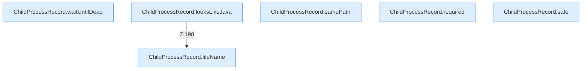

[[00 Start]] › [[Child-Prozess]] › [[Prozess-Bausteine]] › [[ChildProcessRecord]] › [[ChildProcessRecord.Teil2]]

# ChildProcessRecord.Teil2



```knoten
ChildProcessRecord.waitUntilDead
  Dieser Teil macht hier einen einzelnen Schritt. Eine Ebene tiefer steht er genauer. Wartet `waitUntilDead`.
ChildProcessRecord.looksLikeJava
  Dieser Teil macht hier einen einzelnen Schritt. Eine Ebene tiefer steht er genauer. `looksLikeJava` in `ChildProcessRecord.java`. Ruft `fileName`.
ChildProcessRecord.samePath
  Dieser Teil kümmert sich um den Pfad. Vergleicht `samePath`.
ChildProcessRecord.fileName
  Dieser Teil kümmert sich um den Namen. Liefert die Datei `fileName`.
ChildProcessRecord.required
  Dieser Teil macht hier einen einzelnen Schritt. Eine Ebene tiefer steht er genauer. Liest verpflichtend `required`.
ChildProcessRecord.safe
  Dieser Teil macht hier einen einzelnen Schritt. Eine Ebene tiefer steht er genauer. Prüft die Pfadgrenze `safe`.
```

> [!knoten]- Was die Blöcke tun
> - **ChildProcessRecord.waitUntilDead**: Dieser Teil macht hier einen einzelnen Schritt. Eine Ebene tiefer steht er genauer. Wartet `waitUntilDead`.
> - **ChildProcessRecord.looksLikeJava**: Dieser Teil macht hier einen einzelnen Schritt. Eine Ebene tiefer steht er genauer. `looksLikeJava` in `ChildProcessRecord.java`. Ruft `fileName`.
> - **ChildProcessRecord.samePath**: Dieser Teil kümmert sich um den Pfad. Vergleicht `samePath`.
> - **ChildProcessRecord.fileName**: Dieser Teil kümmert sich um den Namen. Liefert die Datei `fileName`.
> - **ChildProcessRecord.required**: Dieser Teil macht hier einen einzelnen Schritt. Eine Ebene tiefer steht er genauer. Liest verpflichtend `required`.
> - **ChildProcessRecord.safe**: Dieser Teil macht hier einen einzelnen Schritt. Eine Ebene tiefer steht er genauer. Prüft die Pfadgrenze `safe`.

- Ein weiterer Abschnitt derselben Übersicht.
