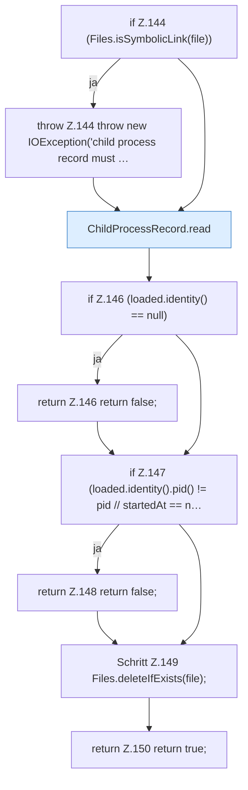

[[00 Start]] › [[Child-Prozess]] › [[Prozess-Bausteine]] › [[ChildProcessRecord]] › [[ChildProcessRecord.Teil1]] › [[ChildProcessRecord.deleteIfMatch]]

# ChildProcessRecord.deleteIfMatch

`ChildProcessRecord.deleteIfMatch(Path file, long pid, Instant startedAt)` [src/main/java/de/aichele/childlauncher/ChildProcessRecord.java:143–151](https://github.com/Sciddie/minecraft-serverhoster-plugin/blob/95b02b953b0b4c23673e900e021a7c3c844aa37d/src/main/java/de/aichele/childlauncher/ChildProcessRecord.java#L143-L151)

- `deleteIfMatch` in `src/main/java/de/aichele/childlauncher/ChildProcessRecord.java`
