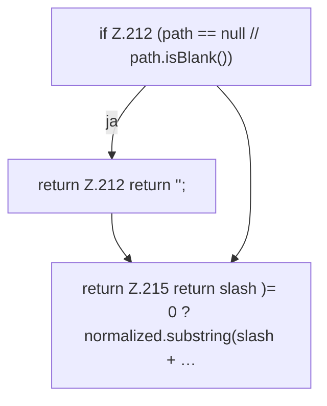

[[00 Start]] › [[Child-Prozess]] › [[Prozess-Bausteine]] › [[ChildProcessRecord]] › [[ChildProcessRecord.Teil2]] › [[ChildProcessRecord.fileName]]

# ChildProcessRecord.fileName

`ChildProcessRecord.fileName(String path)` [src/main/java/de/aichele/childlauncher/ChildProcessRecord.java:211–216](https://github.com/Sciddie/minecraft-serverhoster-plugin/blob/95b02b953b0b4c23673e900e021a7c3c844aa37d/src/main/java/de/aichele/childlauncher/ChildProcessRecord.java#L211-L216)



```knoten
if Z.212 (path == null // path.isBlank())
  Zeile 212: prüft `(path == null // path.isBlank())`.
return Z.212 return '';
  Zeile 212: Rückgabe `return '';`.
return Z.215 return slash )= 0 ? normalized.substring(slash + …
  Zeile 215: Rückgabe `return slash )= 0 ? normalized.substring(slash + …`.
```

> [!knoten]- Was die Blöcke tun
> - **if Z.212 (path == null // path.isBlank())**: Zeile 212: prüft `(path == null // path.isBlank())`.
> - **return Z.212 return '';**: Zeile 212: Rückgabe `return '';`.
> - **return Z.215 return slash )= 0 ? normalized.substring(slash + …**: Zeile 215: Rückgabe `return slash )= 0 ? normalized.substring(slash + …`.

- Dieser Teil kümmert sich um den Namen.
- `fileName` in `src/main/java/de/aichele/childlauncher/ChildProcessRecord.java`
