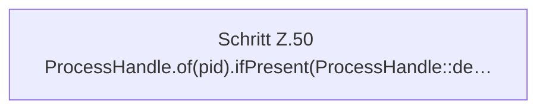

[[00 Start]] › [[Child-Prozess]] › [[Prozess-Bausteine]] › [[ChildProcessRecord]] › [[ChildProcessRecord.Teil1]] › [[ChildProcessRecord.liveInspector]] › [[ChildProcessRecord.liveInspector.destroy]]

# ChildProcessRecord.liveInspector.destroy

`ChildProcessRecord.destroy(long pid)` [src/main/java/de/aichele/childlauncher/ChildProcessRecord.java:49–51](https://github.com/Sciddie/minecraft-serverhoster-plugin/blob/95b02b953b0b4c23673e900e021a7c3c844aa37d/src/main/java/de/aichele/childlauncher/ChildProcessRecord.java#L49-L51)



```knoten
Schritt Z.50 ProcessHandle.of(pid).ifPresent(ProcessHandle::de…
  Zeile 50: fragt den Prozess ab. `ProcessHandle.of(pid).ifPresent(ProcessHandle::de…`
```

- `destroy` in `src/main/java/de/aichele/childlauncher/ChildProcessRecord.java`
- Befund: toter Code, wahrscheinlich. src/main/java/de/aichele/childlauncher/ChildProcessRecord.java:49–51 nur von Tests erreicht
