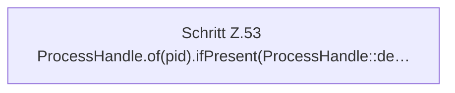

[[00 Start]] › [[Child-Prozess]] › [[Prozess-Bausteine]] › [[ChildProcessRecord]] › [[ChildProcessRecord.Teil1]] › [[ChildProcessRecord.liveInspector]] › [[ChildProcessRecord.liveInspector.destroyForcibly]]

# ChildProcessRecord.liveInspector.destroyForcibly

`ChildProcessRecord.destroyForcibly(long pid)` [src/main/java/de/aichele/childlauncher/ChildProcessRecord.java:52–54](https://github.com/Sciddie/minecraft-serverhoster-plugin/blob/95b02b953b0b4c23673e900e021a7c3c844aa37d/src/main/java/de/aichele/childlauncher/ChildProcessRecord.java#L52-L54)

- `destroyForcibly` in `src/main/java/de/aichele/childlauncher/ChildProcessRecord.java`
- Befund: toter Code, wahrscheinlich. src/main/java/de/aichele/childlauncher/ChildProcessRecord.java:52–54 nur von Tests erreicht
