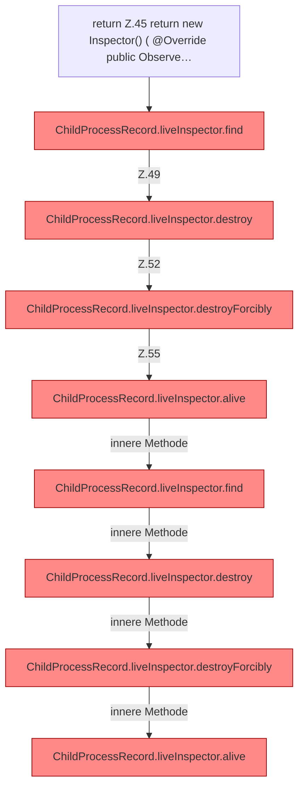

[[00 Start]] › [[Child-Prozess]] › [[Prozess-Bausteine]] › [[ChildProcessRecord]] › [[ChildProcessRecord.Teil1]] › [[ChildProcessRecord.liveInspector]]

# ChildProcessRecord.liveInspector

`ChildProcessRecord.liveInspector()` [src/main/java/de/aichele/childlauncher/ChildProcessRecord.java:44–59](https://github.com/Sciddie/minecraft-serverhoster-plugin/blob/95b02b953b0b4c23673e900e021a7c3c844aa37d/src/main/java/de/aichele/childlauncher/ChildProcessRecord.java#L44-L59)

- `liveInspector` in `src/main/java/de/aichele/childlauncher/ChildProcessRecord.java`
- Befund: toter Code, wahrscheinlich. src/main/java/de/aichele/childlauncher/ChildProcessRecord.java:44–59 nur von Tests erreicht
