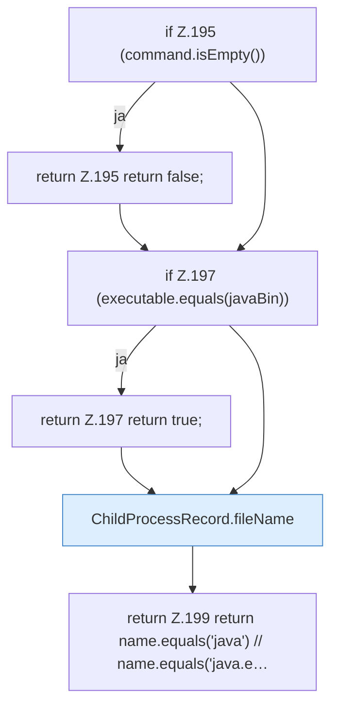

[[00 Start]] › [[Child-Prozess]] › [[Prozess-Bausteine]] › [[ChildProcessRecord]] › [[ChildProcessRecord.Teil2]] › [[ChildProcessRecord.looksLikeJava]]

# ChildProcessRecord.looksLikeJava

`ChildProcessRecord.looksLikeJava(List<String> command, String javaBin)` [src/main/java/de/aichele/childlauncher/ChildProcessRecord.java:194–200](https://github.com/Sciddie/minecraft-serverhoster-plugin/blob/95b02b953b0b4c23673e900e021a7c3c844aa37d/src/main/java/de/aichele/childlauncher/ChildProcessRecord.java#L194-L200)

- `looksLikeJava` in `src/main/java/de/aichele/childlauncher/ChildProcessRecord.java`
