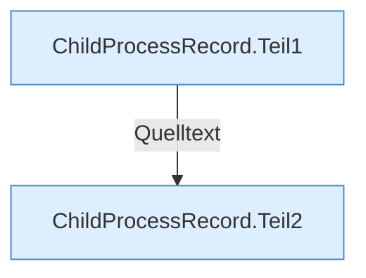

[[00 Start]] › [[Child-Prozess]] › [[Prozess-Bausteine]] › [[ChildProcessRecord]]

# ChildProcessRecord



```knoten
ChildProcessRecord.Teil1
  Abschnitt 1 dieses Ablaufs, in Quellreihenfolge.
ChildProcessRecord.Teil2
  Abschnitt 2 dieses Ablaufs, in Quellreihenfolge.
```


