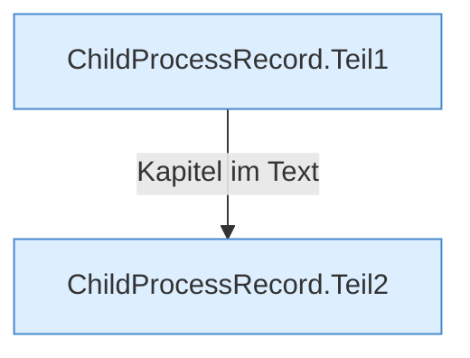

[[00 Start]] › [[Child-Prozess]] › [[Prozess-Bausteine]] › [[ChildProcessRecord]]

# ChildProcessRecord



```knoten
ChildProcessRecord.Teil1
  Ein weiterer Abschnitt derselben Übersicht. Im [[Glossar#Quelltext|Quelltext]] heißt das `Teil1`.
ChildProcessRecord.Teil2
  Ein weiterer Abschnitt derselben Übersicht. Im [[Glossar#Quelltext|Quelltext]] heißt das `Teil2`.
```

> [!knoten]- Was die Blöcke tun
> - **ChildProcessRecord.Teil1**: Ein weiterer Abschnitt derselben Übersicht. Im [[Glossar#Quelltext|Quelltext]] heißt das `Teil1`.
> - **ChildProcessRecord.Teil2**: Ein weiterer Abschnitt derselben Übersicht. Im [[Glossar#Quelltext|Quelltext]] heißt das `Teil2`.

- Der Merkzettel zum laufenden Programm: Nummer, ob es noch lebt, und wie man es beendet.
