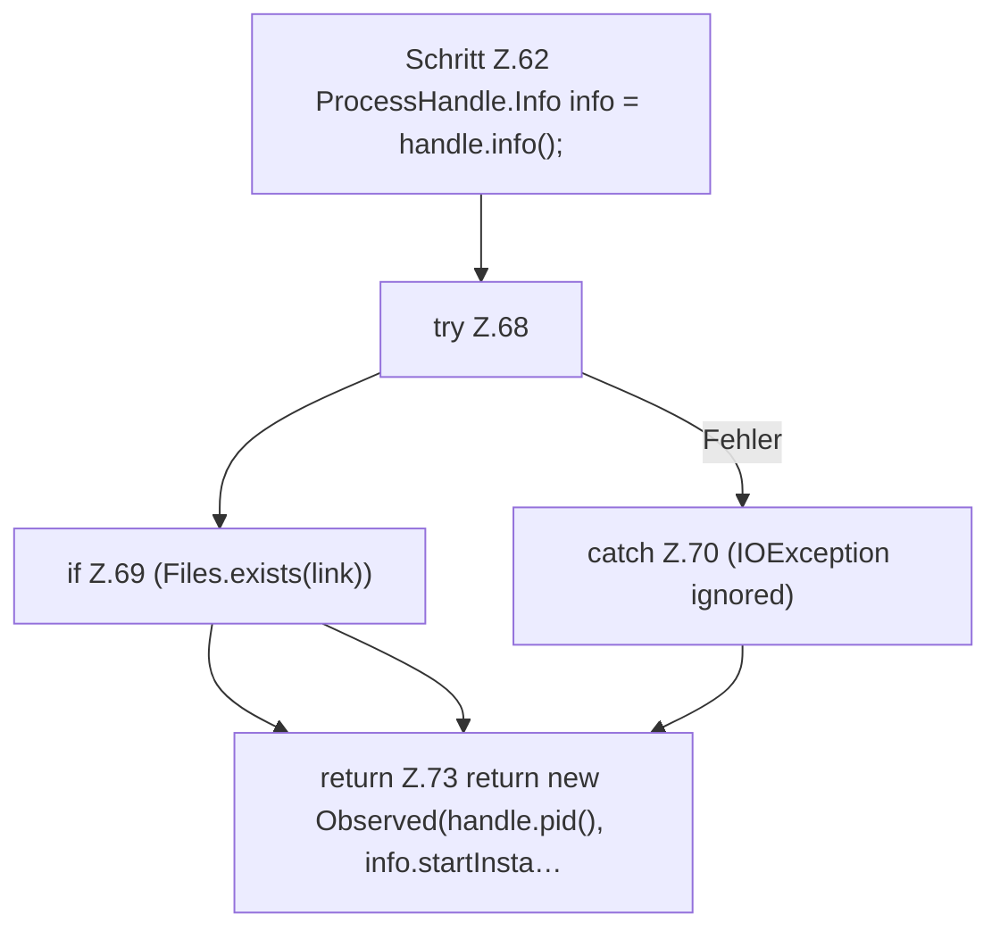

[[00 Start]] › [[Child-Prozess]] › [[Prozess-Bausteine]] › [[ChildProcessRecord]] › [[ChildProcessRecord.Teil1]] › [[ChildProcessRecord.observe]]

# ChildProcessRecord.observe

`ChildProcessRecord.observe(ProcessHandle handle)` [src/main/java/de/aichele/childlauncher/ChildProcessRecord.java:61–74](https://github.com/Sciddie/minecraft-serverhoster-plugin/blob/95b02b953b0b4c23673e900e021a7c3c844aa37d/src/main/java/de/aichele/childlauncher/ChildProcessRecord.java#L61-L74)



```knoten
Schritt Z.62 ProcessHandle.Info info = handle.info();
  Zeile 62: fragt den Prozess ab. `ProcessHandle.Info info = handle.info();`
try Z.68
  Zeile 68: Versuch. Der Fehlerpfad geht in catch.
if Z.69 (Files.exists(link))
  Zeile 69: prüft `(Files.exists(link))`.
catch Z.70 (IOException ignored)
  Zeile 70: fängt (IOException ignored).
return Z.73 return new Observed(handle.pid(), info.startInsta…
  Zeile 73: Rückgabe `return new Observed(handle.pid(), info.startInsta…`.
```

- `observe` in `src/main/java/de/aichele/childlauncher/ChildProcessRecord.java`
- Befund: toter Code, wahrscheinlich. src/main/java/de/aichele/childlauncher/ChildProcessRecord.java:61–74 nur von Tests erreicht
