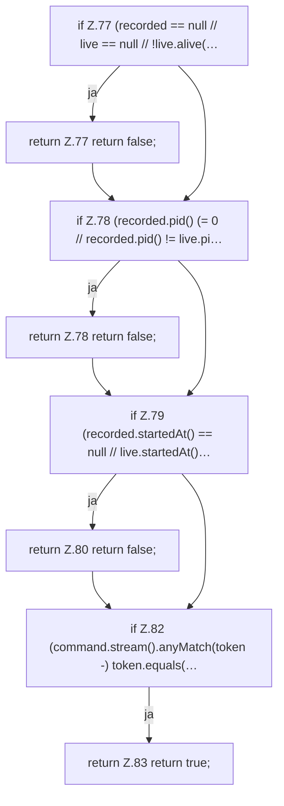

[[00 Start]] › [[Child-Prozess]] › [[Prozess-Bausteine]] › [[ChildProcessRecord]] › [[ChildProcessRecord.Teil1]] › [[ChildProcessRecord.ours]] › [[ChildProcessRecord.ours.Teil1]]

# ChildProcessRecord.ours.Teil1



```knoten
if Z.77 (recorded == null // live == null // !live.alive(…
  Zeile 77: prüft `(recorded == null // live == null // !live.alive(…`.
return Z.77 return false;
  Zeile 77: Rückgabe `return false;`.
if Z.78 (recorded.pid() (= 0 // recorded.pid() != live.pi…
  Zeile 78: prüft `(recorded.pid() (= 0 // recorded.pid() != live.pi…`.
return Z.78 return false;
  Zeile 78: Rückgabe `return false;`.
if Z.79 (recorded.startedAt() == null // live.startedAt()…
  Zeile 79: prüft `(recorded.startedAt() == null // live.startedAt()…`.
return Z.80 return false;
  Zeile 80: Rückgabe `return false;`.
if Z.82 (command.stream().anyMatch(token -) token.equals(…
  Zeile 82: prüft `(command.stream().anyMatch(token -) token.equals(…`.
return Z.83 return true;
  Zeile 83: Rückgabe `return true;`.
```

> [!knoten]- Was die Blöcke tun
> - **if Z.77 (recorded == null // live == null // !live.alive(…**: Zeile 77: prüft `(recorded == null // live == null // !live.alive(…`.
> - **return Z.77 return false;**: Zeile 77: Rückgabe `return false;`.
> - **if Z.78 (recorded.pid() (= 0 // recorded.pid() != live.pi…**: Zeile 78: prüft `(recorded.pid() (= 0 // recorded.pid() != live.pi…`.
> - **return Z.78 return false;**: Zeile 78: Rückgabe `return false;`.
> - **if Z.79 (recorded.startedAt() == null // live.startedAt()…**: Zeile 79: prüft `(recorded.startedAt() == null // live.startedAt()…`.
> - **return Z.80 return false;**: Zeile 80: Rückgabe `return false;`.
> - **if Z.82 (command.stream().anyMatch(token -) token.equals(…**: Zeile 82: prüft `(command.stream().anyMatch(token -) token.equals(…`.
> - **return Z.83 return true;**: Zeile 83: Rückgabe `return true;`.

- Ein weiterer Abschnitt derselben Übersicht.
- Fortsetzung von `ChildProcessRecord.ours`.
