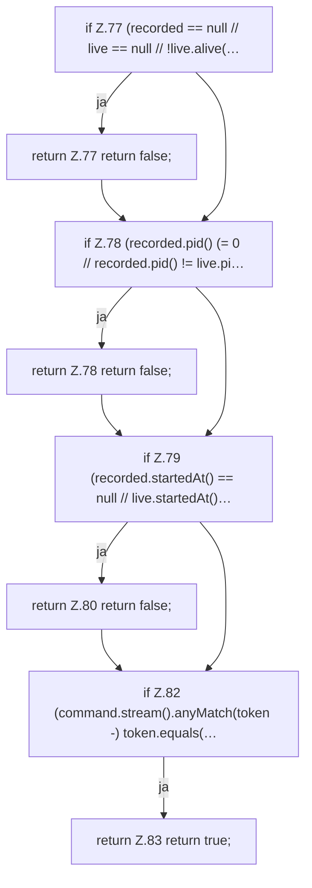

[[00 Start]] › [[Child-Prozess]] › [[Prozess-Bausteine]] › [[ChildProcessRecord]] › [[ChildProcessRecord.Teil1]] › [[ChildProcessRecord.ours]] › [[ChildProcessRecord.ours.Teil1]]

# ChildProcessRecord.ours.Teil1

- Fortsetzung von `ChildProcessRecord.ours`, Quellreihenfolge.
