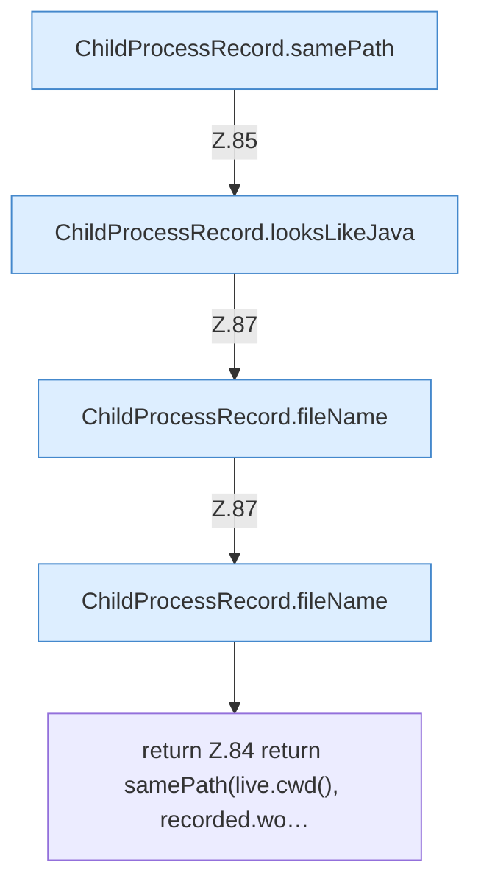

[[00 Start]] › [[Child-Prozess]] › [[Prozess-Bausteine]] › [[ChildProcessRecord]] › [[ChildProcessRecord.Teil1]] › [[ChildProcessRecord.ours]] › [[ChildProcessRecord.ours.Teil2]]

# ChildProcessRecord.ours.Teil2



```knoten
ChildProcessRecord.samePath
  Vergleicht `samePath`.
ChildProcessRecord.looksLikeJava
  `looksLikeJava` in `ChildProcessRecord.java`. Ruft `fileName`.
ChildProcessRecord.fileName
  Liefert die Datei `fileName`.
return Z.84 return samePath(live.cwd(), recorded.wo…
  Zeile 84: Rückgabe `return samePath(live.cwd(), recorded.wo…`.
```

- Fortsetzung von `ChildProcessRecord.ours`, Quellreihenfolge.
