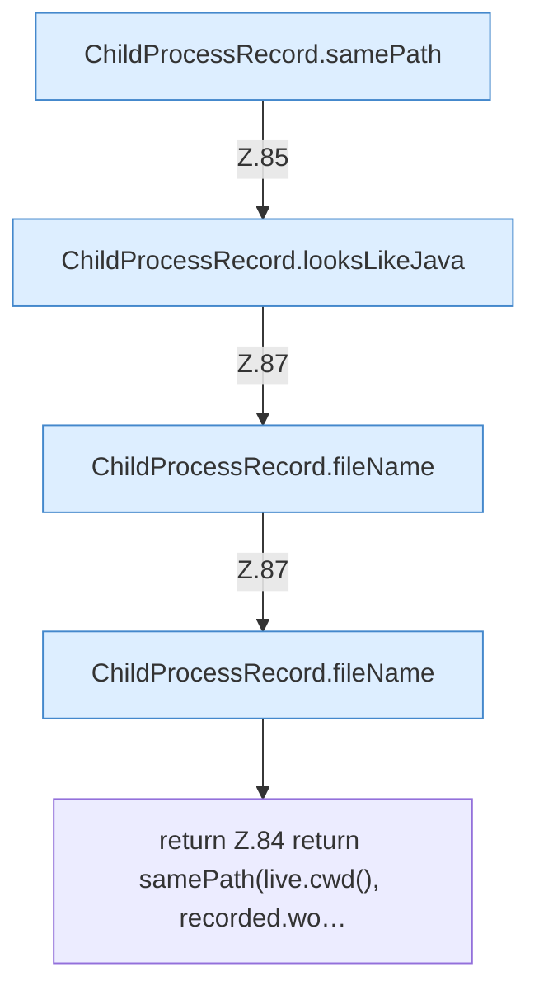

[[00 Start]] › [[Child-Prozess]] › [[Prozess-Bausteine]] › [[ChildProcessRecord]] › [[ChildProcessRecord.Teil1]] › [[ChildProcessRecord.ours]] › [[ChildProcessRecord.ours.Teil2]]

# ChildProcessRecord.ours.Teil2



```knoten
ChildProcessRecord.samePath
  Dieser Teil kümmert sich um den Pfad. Vergleicht `samePath`.
ChildProcessRecord.looksLikeJava
  Dieser Teil macht hier einen einzelnen Schritt. Eine Ebene tiefer steht er genauer. `looksLikeJava` in `ChildProcessRecord.java`. Ruft `fileName`.
ChildProcessRecord.fileName
  Dieser Teil kümmert sich um den Namen. Liefert die Datei `fileName`.
return Z.84 return samePath(live.cwd(), recorded.wo…
  Zeile 84: Rückgabe `return samePath(live.cwd(), recorded.wo…`.
```

> [!knoten]- Was die Blöcke tun
> - **ChildProcessRecord.samePath**: Dieser Teil kümmert sich um den Pfad. Vergleicht `samePath`.
> - **ChildProcessRecord.looksLikeJava**: Dieser Teil macht hier einen einzelnen Schritt. Eine Ebene tiefer steht er genauer. `looksLikeJava` in `ChildProcessRecord.java`. Ruft `fileName`.
> - **ChildProcessRecord.fileName**: Dieser Teil kümmert sich um den Namen. Liefert die Datei `fileName`.
> - **return Z.84 return samePath(live.cwd(), recorded.wo…**: Zeile 84: Rückgabe `return samePath(live.cwd(), recorded.wo…`.

- Ein weiterer Abschnitt derselben Übersicht.
- Fortsetzung von `ChildProcessRecord.ours`.
