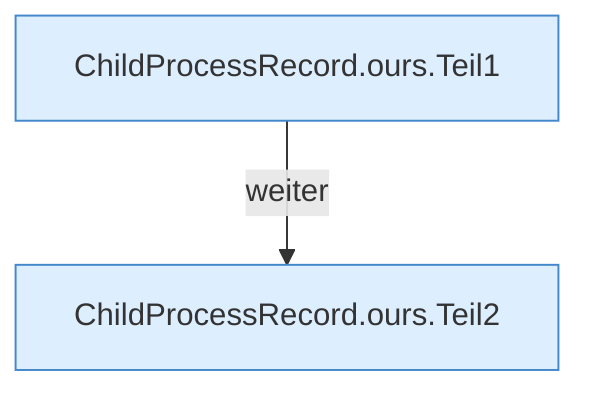

[[00 Start]] › [[Child-Prozess]] › [[Prozess-Bausteine]] › [[ChildProcessRecord]] › [[ChildProcessRecord.Teil1]] › [[ChildProcessRecord.ours]]

# ChildProcessRecord.ours

`ChildProcessRecord.ours(Identity recorded, Observed live, long selfPid)` [src/main/java/de/aichele/childlauncher/ChildProcessRecord.java:76–88](https://github.com/Sciddie/minecraft-serverhoster-plugin/blob/95b02b953b0b4c23673e900e021a7c3c844aa37d/src/main/java/de/aichele/childlauncher/ChildProcessRecord.java#L76-L88)

- `ours` in `src/main/java/de/aichele/childlauncher/ChildProcessRecord.java`
