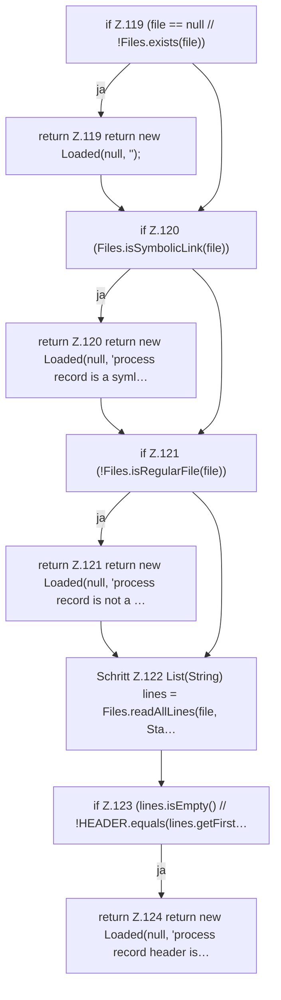

[[00 Start]] › [[Child-Prozess]] › [[Prozess-Bausteine]] › [[ChildProcessRecord]] › [[ChildProcessRecord.Teil1]] › [[ChildProcessRecord.read]] › [[ChildProcessRecord.read.Z118.Teil1]]

# ChildProcessRecord.read.Z118.Teil1

- Fortsetzung von `ChildProcessRecord.read.Z118`, Quellreihenfolge.
