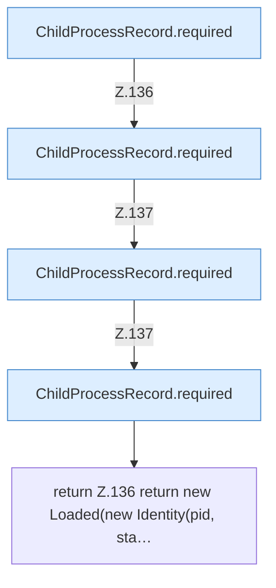

[[00 Start]] › [[Child-Prozess]] › [[Prozess-Bausteine]] › [[ChildProcessRecord]] › [[ChildProcessRecord.Teil1]] › [[ChildProcessRecord.read]] › [[ChildProcessRecord.read.Z118.Teil3]]

# ChildProcessRecord.read.Z118.Teil3



```knoten
ChildProcessRecord.required
  Liest verpflichtend `required`.
return Z.136 return new Loaded(new Identity(pid, sta…
  Zeile 136: Rückgabe `return new Loaded(new Identity(pid, sta…`.
```

- Fortsetzung von `ChildProcessRecord.read.Z118`, Quellreihenfolge.
