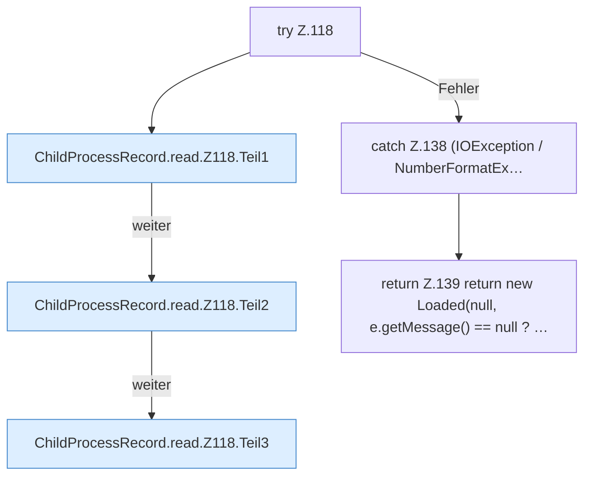

[[00 Start]] › [[Child-Prozess]] › [[Prozess-Bausteine]] › [[ChildProcessRecord]] › [[ChildProcessRecord.Teil1]] › [[ChildProcessRecord.read]] › [[ChildProcessRecord.read.Z118]]

# ChildProcessRecord.read.Z118



```knoten
try Z.118
  Zeile 118: Versuch. Der Fehlerpfad geht in catch.
ChildProcessRecord.read.Z118.Teil1
  Ein weiterer Abschnitt derselben Übersicht. Abschnitt 1 dieses Ablaufs, in Quellreihenfolge.
ChildProcessRecord.read.Z118.Teil2
  Ein weiterer Abschnitt derselben Übersicht. Abschnitt 2 dieses Ablaufs, in Quellreihenfolge.
ChildProcessRecord.read.Z118.Teil3
  Ein weiterer Abschnitt derselben Übersicht. Abschnitt 3 dieses Ablaufs, in Quellreihenfolge.
catch Z.138 (IOException / NumberFormatEx…
  Zeile 138: fängt (IOException / NumberFormatEx….
return Z.139 return new Loaded(null, e.getMessage() == null ? …
  Zeile 139: Rückgabe `return new Loaded(null, e.getMessage() == null ? …`.
```

> [!knoten]- Was die Blöcke tun
> - **try Z.118**: Zeile 118: Versuch. Der Fehlerpfad geht in catch.
> - **ChildProcessRecord.read.Z118.Teil1**: Ein weiterer Abschnitt derselben Übersicht. Abschnitt 1 dieses Ablaufs, in Quellreihenfolge.
> - **ChildProcessRecord.read.Z118.Teil2**: Ein weiterer Abschnitt derselben Übersicht. Abschnitt 2 dieses Ablaufs, in Quellreihenfolge.
> - **ChildProcessRecord.read.Z118.Teil3**: Ein weiterer Abschnitt derselben Übersicht. Abschnitt 3 dieses Ablaufs, in Quellreihenfolge.
> - **catch Z.138 (IOException / NumberFormatEx…**: Zeile 138: fängt (IOException / NumberFormatEx….
> - **return Z.139 return new Loaded(null, e.getMessage() == null ? …**: Zeile 139: Rückgabe `return new Loaded(null, e.getMessage() == null ? …`.

- Der Ablauf geht in [[Glossar#Zeile|Zeile]] 118 weiter. Eine Ebene tiefer steht er genauer.
- Fortsetzung von `ChildProcessRecord.read`.
