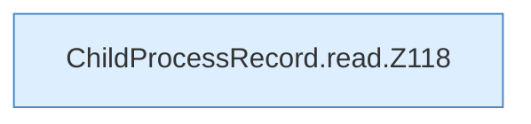

[[00 Start]] › [[Child-Prozess]] › [[Prozess-Bausteine]] › [[ChildProcessRecord]] › [[ChildProcessRecord.Teil1]] › [[ChildProcessRecord.read]]

# ChildProcessRecord.read

`ChildProcessRecord.read(Path file)` [src/main/java/de/aichele/childlauncher/ChildProcessRecord.java:117–141](https://github.com/Sciddie/minecraft-serverhoster-plugin/blob/95b02b953b0b4c23673e900e021a7c3c844aa37d/src/main/java/de/aichele/childlauncher/ChildProcessRecord.java#L117-L141)



```knoten
ChildProcessRecord.read.Z118
  Fortsetzung des Ablaufs ab Zeile 118.
```

- `read` in `src/main/java/de/aichele/childlauncher/ChildProcessRecord.java`
