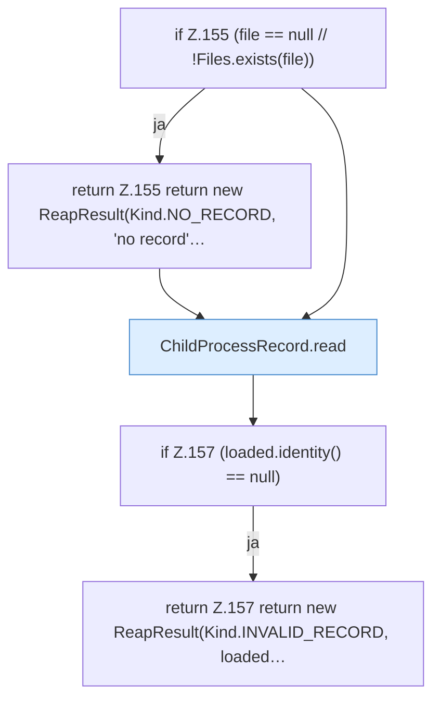

[[00 Start]] › [[Child-Prozess]] › [[Prozess-Bausteine]] › [[ChildProcessRecord]] › [[ChildProcessRecord.Teil1]] › [[ChildProcessRecord.reap]] › [[ChildProcessRecord.reap.Teil1]]

# ChildProcessRecord.reap.Teil1

- Fortsetzung von `ChildProcessRecord.reap`, Quellreihenfolge.
