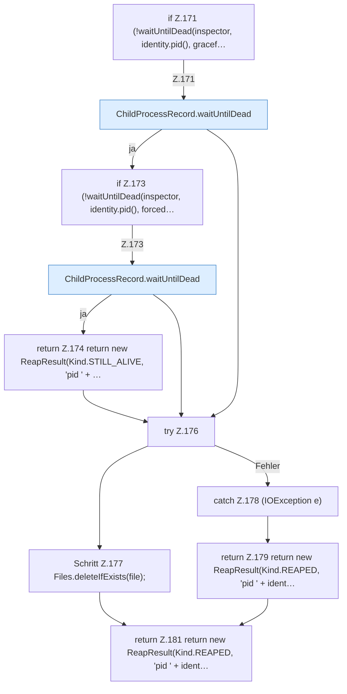

[[00 Start]] › [[Child-Prozess]] › [[Prozess-Bausteine]] › [[ChildProcessRecord]] › [[ChildProcessRecord.Teil1]] › [[ChildProcessRecord.reap]] › [[ChildProcessRecord.reap.Teil3]]

# ChildProcessRecord.reap.Teil3



```knoten
if Z.171 (!waitUntilDead(inspector, identity.pid(), gracef…
  Zeile 171: prüft `(!waitUntilDead(inspector, identity.pid(), gracef…`.
ChildProcessRecord.waitUntilDead
  Dieser Teil macht hier einen einzelnen Schritt. Eine Ebene tiefer steht er genauer. Wartet `waitUntilDead`.
if Z.173 (!waitUntilDead(inspector, identity.pid(), forced…
  Zeile 173: prüft `(!waitUntilDead(inspector, identity.pid(), forced…`.
return Z.174 return new ReapResult(Kind.STILL_ALIVE, 'pid ' + …
  Zeile 174: Rückgabe `return new ReapResult(Kind.STILL_ALIVE, 'pid ' + …`.
try Z.176
  Zeile 176: Versuch. Der Fehlerpfad geht in catch.
Schritt Z.177 Files.deleteIfExists(file);
  Zeile 177: Dateioperation. `Files.deleteIfExists(file);`
catch Z.178 (IOException e)
  Zeile 178: fängt (IOException e).
return Z.179 return new ReapResult(Kind.REAPED, 'pid ' + ident…
  Zeile 179: Rückgabe `return new ReapResult(Kind.REAPED, 'pid ' + ident…`.
return Z.181 return new ReapResult(Kind.REAPED, 'pid ' + ident…
  Zeile 181: Rückgabe `return new ReapResult(Kind.REAPED, 'pid ' + ident…`.
```

> [!knoten]- Was die Blöcke tun
> - **if Z.171 (!waitUntilDead(inspector, identity.pid(), gracef…**: Zeile 171: prüft `(!waitUntilDead(inspector, identity.pid(), gracef…`.
> - **ChildProcessRecord.waitUntilDead**: Dieser Teil macht hier einen einzelnen Schritt. Eine Ebene tiefer steht er genauer. Wartet `waitUntilDead`.
> - **if Z.173 (!waitUntilDead(inspector, identity.pid(), forced…**: Zeile 173: prüft `(!waitUntilDead(inspector, identity.pid(), forced…`.
> - **return Z.174 return new ReapResult(Kind.STILL_ALIVE, 'pid ' + …**: Zeile 174: Rückgabe `return new ReapResult(Kind.STILL_ALIVE, 'pid ' + …`.
> - **try Z.176**: Zeile 176: Versuch. Der Fehlerpfad geht in catch.
> - **Schritt Z.177 Files.deleteIfExists(file);**: Zeile 177: Dateioperation. `Files.deleteIfExists(file);`
> - **catch Z.178 (IOException e)**: Zeile 178: fängt (IOException e).
> - **return Z.179 return new ReapResult(Kind.REAPED, 'pid ' + ident…**: Zeile 179: Rückgabe `return new ReapResult(Kind.REAPED, 'pid ' + ident…`.
> - **return Z.181 return new ReapResult(Kind.REAPED, 'pid ' + ident…**: Zeile 181: Rückgabe `return new ReapResult(Kind.REAPED, 'pid ' + ident…`.

- Ein weiterer Abschnitt derselben Übersicht.
- Fortsetzung von `ChildProcessRecord.reap`.
