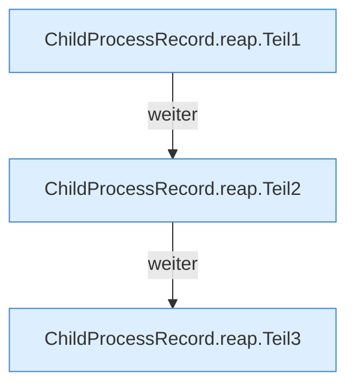

[[00 Start]] › [[Child-Prozess]] › [[Prozess-Bausteine]] › [[ChildProcessRecord]] › [[ChildProcessRecord.Teil1]] › [[ChildProcessRecord.reap]]

# ChildProcessRecord.reap

`ChildProcessRecord.reap(Path file, Duration graceful, Duration forced, Inspector inspector, long selfPid)` [src/main/java/de/aichele/childlauncher/ChildProcessRecord.java:153–182](https://github.com/Sciddie/minecraft-serverhoster-plugin/blob/95b02b953b0b4c23673e900e021a7c3c844aa37d/src/main/java/de/aichele/childlauncher/ChildProcessRecord.java#L153-L182)



```knoten
ChildProcessRecord.reap.Teil1
  Abschnitt 1 dieses Ablaufs, in Quellreihenfolge.
ChildProcessRecord.reap.Teil2
  Abschnitt 2 dieses Ablaufs, in Quellreihenfolge.
ChildProcessRecord.reap.Teil3
  Abschnitt 3 dieses Ablaufs, in Quellreihenfolge.
```

- `reap` in `src/main/java/de/aichele/childlauncher/ChildProcessRecord.java`
