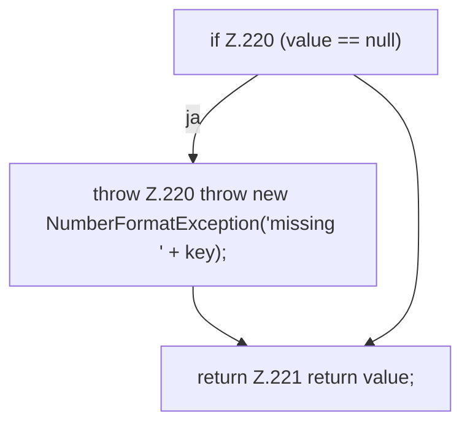

[[00 Start]] › [[Child-Prozess]] › [[Prozess-Bausteine]] › [[ChildProcessRecord]] › [[ChildProcessRecord.Teil2]] › [[ChildProcessRecord.required]]

# ChildProcessRecord.required

`ChildProcessRecord.required(Map<String, String> values, String key)` [src/main/java/de/aichele/childlauncher/ChildProcessRecord.java:218–222](https://github.com/Sciddie/minecraft-serverhoster-plugin/blob/95b02b953b0b4c23673e900e021a7c3c844aa37d/src/main/java/de/aichele/childlauncher/ChildProcessRecord.java#L218-L222)



```knoten
if Z.220 (value == null)
  Zeile 220: prüft `(value == null)`.
throw Z.220 throw new NumberFormatException('missing ' + key);
  Zeile 220: Abbruch `throw new NumberFormatException('missing ' + key);`.
return Z.221 return value;
  Zeile 221: Rückgabe `return value;`.
```

- `required` in `src/main/java/de/aichele/childlauncher/ChildProcessRecord.java`
