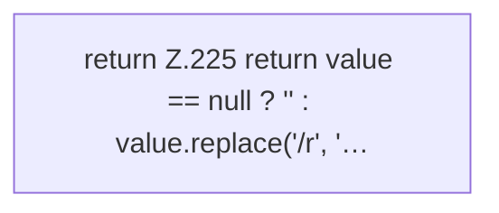

[[00 Start]] › [[Child-Prozess]] › [[Prozess-Bausteine]] › [[ChildProcessRecord]] › [[ChildProcessRecord.Teil2]] › [[ChildProcessRecord.safe]]

# ChildProcessRecord.safe

`ChildProcessRecord.safe(String value)` [src/main/java/de/aichele/childlauncher/ChildProcessRecord.java:224–226](https://github.com/Sciddie/minecraft-serverhoster-plugin/blob/95b02b953b0b4c23673e900e021a7c3c844aa37d/src/main/java/de/aichele/childlauncher/ChildProcessRecord.java#L224-L226)



```knoten
return Z.225 return value == null ? '' : value.replace('/r', '…
  Zeile 225: Rückgabe `return value == null ? '' : value.replace('/r', '…`.
```

> [!knoten]- Was die Blöcke tun
> - **return Z.225 return value == null ? '' : value.replace('/r', '…**: Zeile 225: Rückgabe `return value == null ? '' : value.replace('/r', '…`.

- Dieser Teil macht hier einen einzelnen Schritt. Eine Ebene tiefer steht er genauer.
- `safe` in `src/main/java/de/aichele/childlauncher/ChildProcessRecord.java`
