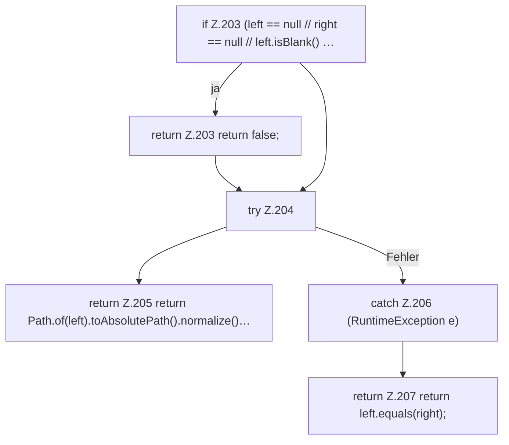

[[00 Start]] › [[Child-Prozess]] › [[Prozess-Bausteine]] › [[ChildProcessRecord]] › [[ChildProcessRecord.Teil2]] › [[ChildProcessRecord.samePath]]

# ChildProcessRecord.samePath

`ChildProcessRecord.samePath(String left, String right)` [src/main/java/de/aichele/childlauncher/ChildProcessRecord.java:202–209](https://github.com/Sciddie/minecraft-serverhoster-plugin/blob/95b02b953b0b4c23673e900e021a7c3c844aa37d/src/main/java/de/aichele/childlauncher/ChildProcessRecord.java#L202-L209)

- `samePath` in `src/main/java/de/aichele/childlauncher/ChildProcessRecord.java`
