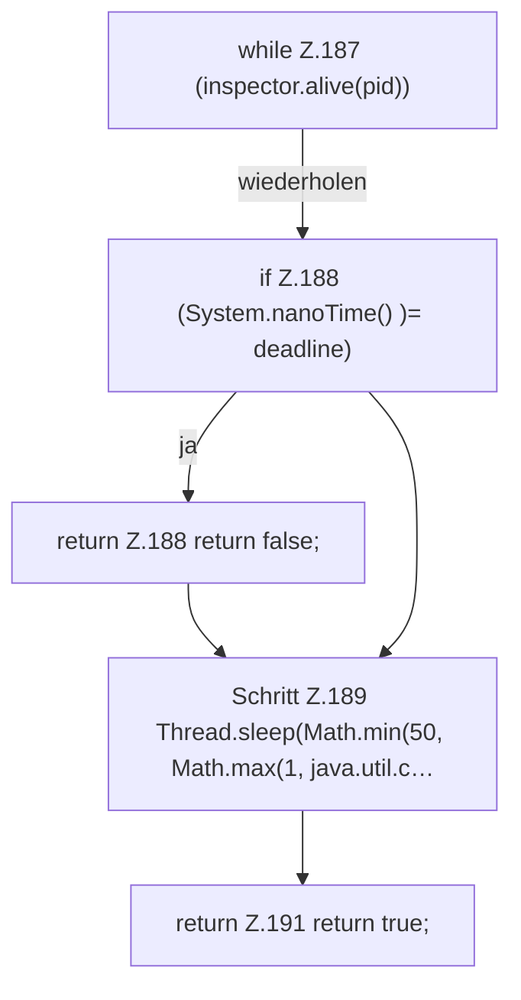

[[00 Start]] › [[Child-Prozess]] › [[Prozess-Bausteine]] › [[ChildProcessRecord]] › [[ChildProcessRecord.Teil2]] › [[ChildProcessRecord.waitUntilDead]]

# ChildProcessRecord.waitUntilDead

`ChildProcessRecord.waitUntilDead(Inspector inspector, long pid, Duration timeout)` [src/main/java/de/aichele/childlauncher/ChildProcessRecord.java:184–192](https://github.com/Sciddie/minecraft-serverhoster-plugin/blob/95b02b953b0b4c23673e900e021a7c3c844aa37d/src/main/java/de/aichele/childlauncher/ChildProcessRecord.java#L184-L192)



```knoten
while Z.187 (inspector.alive(pid))
  Zeile 187: Schleife `(inspector.alive(pid))`.
if Z.188 (System.nanoTime() )= deadline)
  Zeile 188: prüft `(System.nanoTime() )= deadline)`.
return Z.188 return false;
  Zeile 188: Rückgabe `return false;`.
Schritt Z.189 Thread.sleep(Math.min(50, Math.max(1, java.util.c…
  Zeile 189: wartet. `Thread.sleep(Math.min(50, Math.max(1, java.util.c…`
return Z.191 return true;
  Zeile 191: Rückgabe `return true;`.
```

> [!knoten]- Was die Blöcke tun
> - **while Z.187 (inspector.alive(pid))**: Zeile 187: Schleife `(inspector.alive(pid))`.
> - **if Z.188 (System.nanoTime() )= deadline)**: Zeile 188: prüft `(System.nanoTime() )= deadline)`.
> - **return Z.188 return false;**: Zeile 188: Rückgabe `return false;`.
> - **Schritt Z.189 Thread.sleep(Math.min(50, Math.max(1, java.util.c…**: Zeile 189: wartet. `Thread.sleep(Math.min(50, Math.max(1, java.util.c…`
> - **return Z.191 return true;**: Zeile 191: Rückgabe `return true;`.

- Dieser Teil macht hier einen einzelnen Schritt. Eine Ebene tiefer steht er genauer.
- `waitUntilDead` in `src/main/java/de/aichele/childlauncher/ChildProcessRecord.java`
