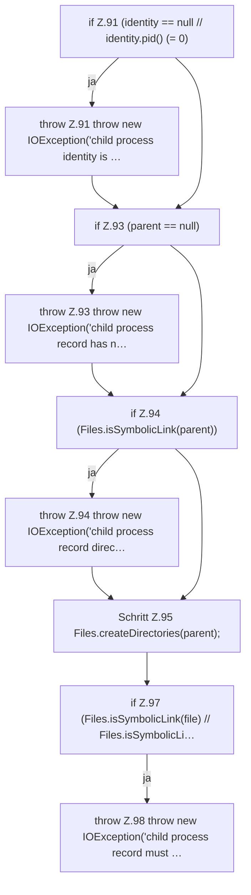

[[00 Start]] › [[Child-Prozess]] › [[Prozess-Bausteine]] › [[ChildProcessRecord]] › [[ChildProcessRecord.Teil1]] › [[ChildProcessRecord.write]] › [[ChildProcessRecord.write.Teil1]]

# ChildProcessRecord.write.Teil1

- Fortsetzung von `ChildProcessRecord.write`, Quellreihenfolge.
