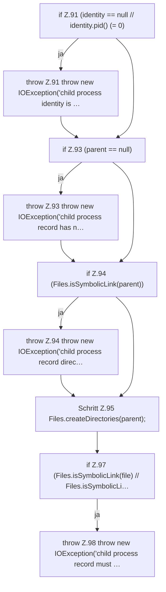

[[00 Start]] › [[Child-Prozess]] › [[Prozess-Bausteine]] › [[ChildProcessRecord]] › [[ChildProcessRecord.Teil1]] › [[ChildProcessRecord.write]] › [[ChildProcessRecord.write.Teil1]]

# ChildProcessRecord.write.Teil1



```knoten
if Z.91 (identity == null // identity.pid() (= 0)
  Zeile 91: prüft `(identity == null // identity.pid() (= 0)`.
throw Z.91 throw new IOException('child process identity is …
  Zeile 91: Abbruch `throw new IOException('child process identity is …`.
if Z.93 (parent == null)
  Zeile 93: prüft `(parent == null)`.
throw Z.93 throw new IOException('child process record has n…
  Zeile 93: Abbruch `throw new IOException('child process record has n…`.
if Z.94 (Files.isSymbolicLink(parent))
  Zeile 94: prüft `(Files.isSymbolicLink(parent))`.
throw Z.94 throw new IOException('child process record direc…
  Zeile 94: Abbruch `throw new IOException('child process record direc…`.
Schritt Z.95 Files.createDirectories(parent);
  Zeile 95: Dateioperation. `Files.createDirectories(parent);`
if Z.97 (Files.isSymbolicLink(file) // Files.isSymbolicLi…
  Zeile 97: prüft `(Files.isSymbolicLink(file) // Files.isSymbolicLi…`.
throw Z.98 throw new IOException('child process record must …
  Zeile 98: Abbruch `throw new IOException('child process record must …`.
```

- Fortsetzung von `ChildProcessRecord.write`, Quellreihenfolge.
