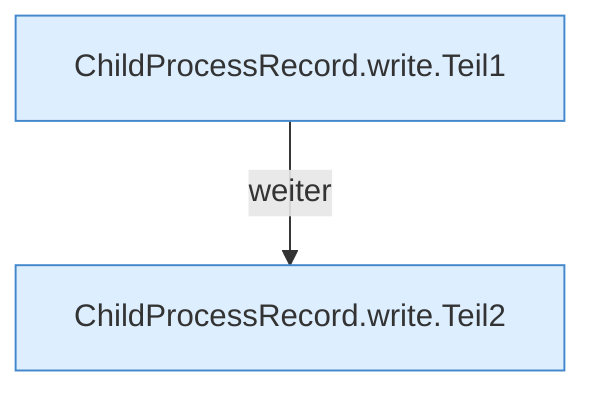

[[00 Start]] › [[Child-Prozess]] › [[Prozess-Bausteine]] › [[ChildProcessRecord]] › [[ChildProcessRecord.Teil1]] › [[ChildProcessRecord.write]]

# ChildProcessRecord.write

`ChildProcessRecord.write(Path file, Identity identity)` [src/main/java/de/aichele/childlauncher/ChildProcessRecord.java:90–115](https://github.com/Sciddie/minecraft-serverhoster-plugin/blob/95b02b953b0b4c23673e900e021a7c3c844aa37d/src/main/java/de/aichele/childlauncher/ChildProcessRecord.java#L90-L115)



```knoten
ChildProcessRecord.write.Teil1
  Ein weiterer Abschnitt derselben Übersicht. Abschnitt 1 dieses Ablaufs, in Quellreihenfolge.
ChildProcessRecord.write.Teil2
  Ein weiterer Abschnitt derselben Übersicht. Abschnitt 2 dieses Ablaufs, in Quellreihenfolge.
```

> [!knoten]- Was die Blöcke tun
> - **ChildProcessRecord.write.Teil1**: Ein weiterer Abschnitt derselben Übersicht. Abschnitt 1 dieses Ablaufs, in Quellreihenfolge.
> - **ChildProcessRecord.write.Teil2**: Ein weiterer Abschnitt derselben Übersicht. Abschnitt 2 dieses Ablaufs, in Quellreihenfolge.

- Dieser Teil schreibt das.
- `write` in `src/main/java/de/aichele/childlauncher/ChildProcessRecord.java`
