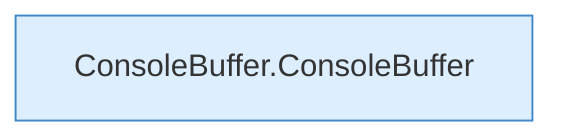

[[00 Start]] › [[Child-Prozess]] › [[Prozess-Bausteine]] › [[ChildSlot]] › [[ChildSlot.ChildSlot]]

# ChildSlot.ChildSlot

`ChildSlot.ChildSlot(String id, int consoleCap)` [src/main/java/de/aichele/childlauncher/ChildSlot.java:45–45](https://github.com/Sciddie/minecraft-serverhoster-plugin/blob/95b02b953b0b4c23673e900e021a7c3c844aa37d/src/main/java/de/aichele/childlauncher/ChildSlot.java#L45-L45)



```knoten
ConsoleBuffer.ConsoleBuffer
  Liefert die Konsole `ConsoleBuffer`.
```

- `ChildSlot` in `src/main/java/de/aichele/childlauncher/ChildSlot.java`
