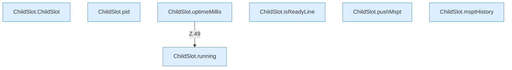

[[00 Start]] › [[Child-Prozess]] › [[Prozess-Bausteine]] › [[ChildSlot]]

# ChildSlot



```knoten
ChildSlot.ChildSlot
  Betrifft den Child `ChildSlot`. Ruft `ConsoleBuffer`.
ChildSlot.running
  Sagt, ob der Prozess läuft `running`.
ChildSlot.pid
  Liefert die Prozessnummer `pid`.
ChildSlot.uptimeMillis
  Liefert die Laufzeit `uptimeMillis`. Ruft `running`.
ChildSlot.isReadyLine
  Prüft `isReadyLine`.
ChildSlot.pushMspt
  Schiebt einen Wert in `pushMspt`.
ChildSlot.msptHistory
  Liefert die Tickzeiten `msptHistory`.
```


