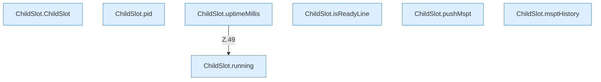

[[00 Start]] › [[Child-Prozess]] › [[Prozess-Bausteine]] › [[ChildSlot]]

# ChildSlot



```knoten
ChildSlot.ChildSlot
  Dieser Teil kümmert sich um den [[Glossar#Platz|Platz]]. Im [[Glossar#Quelltext|Quelltext]] heißt das `ChildSlot`.
ChildSlot.running
  Dieser Teil prüft, ob läuft, das. Im [[Glossar#Quelltext|Quelltext]] heißt das `running`.
ChildSlot.pid
  Dieser Teil macht hier einen einzelnen Schritt. Eine Ebene tiefer steht er genauer. Im [[Glossar#Quelltext|Quelltext]] heißt das `pid`.
ChildSlot.uptimeMillis
  Dieser Teil kümmert sich um die Zeit. Im [[Glossar#Quelltext|Quelltext]] heißt das `uptimeMillis`.
ChildSlot.isReadyLine
  Dieser Teil prüft eine [[Glossar#Zeile|Zeile]]. Im [[Glossar#Quelltext|Quelltext]] heißt das `isReadyLine`.
ChildSlot.pushMspt
  Dieser Teil kümmert sich um die [[Glossar#Spielschritt|Spielschritte]]. Im [[Glossar#Quelltext|Quelltext]] heißt das `pushMspt`.
ChildSlot.msptHistory
  Dieser Teil kümmert sich um den Verlauf. Im [[Glossar#Quelltext|Quelltext]] heißt das `msptHistory`.
```

> [!knoten]- Was die Blöcke tun
> - **ChildSlot.ChildSlot**: Dieser Teil kümmert sich um den [[Glossar#Platz|Platz]]. Im [[Glossar#Quelltext|Quelltext]] heißt das `ChildSlot`.
> - **ChildSlot.running**: Dieser Teil prüft, ob läuft, das. Im [[Glossar#Quelltext|Quelltext]] heißt das `running`.
> - **ChildSlot.pid**: Dieser Teil macht hier einen einzelnen Schritt. Eine Ebene tiefer steht er genauer. Im [[Glossar#Quelltext|Quelltext]] heißt das `pid`.
> - **ChildSlot.uptimeMillis**: Dieser Teil kümmert sich um die Zeit. Im [[Glossar#Quelltext|Quelltext]] heißt das `uptimeMillis`.
> - **ChildSlot.isReadyLine**: Dieser Teil prüft eine [[Glossar#Zeile|Zeile]]. Im [[Glossar#Quelltext|Quelltext]] heißt das `isReadyLine`.
> - **ChildSlot.pushMspt**: Dieser Teil kümmert sich um die [[Glossar#Spielschritt|Spielschritte]]. Im [[Glossar#Quelltext|Quelltext]] heißt das `pushMspt`.
> - **ChildSlot.msptHistory**: Dieser Teil kümmert sich um den Verlauf. Im [[Glossar#Quelltext|Quelltext]] heißt das `msptHistory`.

- Der [[Glossar#Platz|Platz]] des [[Glossar#Spielserver|Spielservers]]: Zustand, Programmnummer, [[Glossar#Konsole|Konsole]] und Messwerte.
