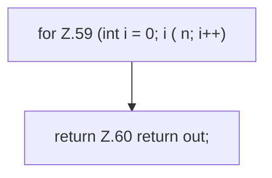

[[00 Start]] › [[Child-Prozess]] › [[Prozess-Bausteine]] › [[ChildSlot]] › [[ChildSlot.msptHistory]]

# ChildSlot.msptHistory

`ChildSlot.msptHistory()` [src/main/java/de/aichele/childlauncher/ChildSlot.java:55–61](https://github.com/Sciddie/minecraft-serverhoster-plugin/blob/95b02b953b0b4c23673e900e021a7c3c844aa37d/src/main/java/de/aichele/childlauncher/ChildSlot.java#L55-L61)



```knoten
for Z.59 (int i = 0; i ( n; i++)
  Zeile 59: Schleife `(int i = 0; i ( n; i++)`.
return Z.60 return out;
  Zeile 60: Rückgabe `return out;`.
```

> [!knoten]- Was die Blöcke tun
> - **for Z.59 (int i = 0; i ( n; i++)**: Zeile 59: Schleife `(int i = 0; i ( n; i++)`.
> - **return Z.60 return out;**: Zeile 60: Rückgabe `return out;`.

- Dieser Teil kümmert sich um den Verlauf.
- `msptHistory` in `src/main/java/de/aichele/childlauncher/ChildSlot.java`
