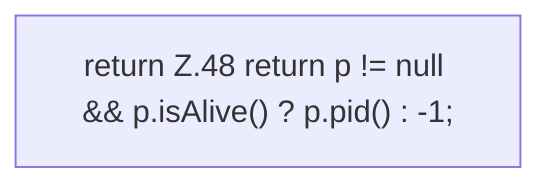

[[00 Start]] › [[Child-Prozess]] › [[Prozess-Bausteine]] › [[ChildSlot]] › [[ChildSlot.pid]]

# ChildSlot.pid

`ChildSlot.pid()` [src/main/java/de/aichele/childlauncher/ChildSlot.java:48–48](https://github.com/Sciddie/minecraft-serverhoster-plugin/blob/95b02b953b0b4c23673e900e021a7c3c844aa37d/src/main/java/de/aichele/childlauncher/ChildSlot.java#L48-L48)



```knoten
return Z.48 return p != null && p.isAlive() ? p.pid() : -1;
  Zeile 48: Rückgabe `return p != null && p.isAlive() ? p.pid() : -1;`.
```

- `pid` in `src/main/java/de/aichele/childlauncher/ChildSlot.java`
