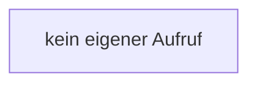

[[00 Start]] › [[Child-Prozess]] › [[Prozess-Bausteine]] › [[ChildSlot]] › [[ChildSlot.pushMspt]]

# ChildSlot.pushMspt

`ChildSlot.pushMspt(double v)` [src/main/java/de/aichele/childlauncher/ChildSlot.java:53–53](https://github.com/Sciddie/minecraft-serverhoster-plugin/blob/95b02b953b0b4c23673e900e021a7c3c844aa37d/src/main/java/de/aichele/childlauncher/ChildSlot.java#L53-L53)



```knoten
kein eigener Aufruf
  In diesem Stück gibt es keinen weiteren eigenen Aufruf.
```

> [!knoten]- Was die Blöcke tun
> - **kein eigener Aufruf**: In diesem Stück gibt es keinen weiteren eigenen Aufruf.

- Dieser Teil kümmert sich um die [[Glossar#Spielschritt|Spielschritte]].
- `pushMspt` in `src/main/java/de/aichele/childlauncher/ChildSlot.java`
