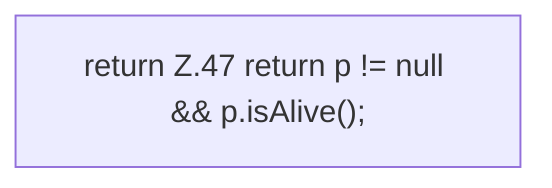

[[00 Start]] › [[Child-Prozess]] › [[Prozess-Bausteine]] › [[ChildSlot]] › [[ChildSlot.running]]

# ChildSlot.running

`ChildSlot.running()` [src/main/java/de/aichele/childlauncher/ChildSlot.java:47–47](https://github.com/Sciddie/minecraft-serverhoster-plugin/blob/95b02b953b0b4c23673e900e021a7c3c844aa37d/src/main/java/de/aichele/childlauncher/ChildSlot.java#L47-L47)



```knoten
return Z.47 return p != null && p.isAlive();
  Zeile 47: Rückgabe `return p != null && p.isAlive();`.
```

- `running` in `src/main/java/de/aichele/childlauncher/ChildSlot.java`
