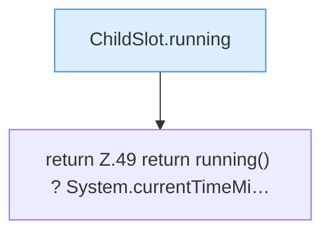

[[00 Start]] › [[Child-Prozess]] › [[Prozess-Bausteine]] › [[ChildSlot]] › [[ChildSlot.uptimeMillis]]

# ChildSlot.uptimeMillis

`ChildSlot.uptimeMillis()` [src/main/java/de/aichele/childlauncher/ChildSlot.java:49–49](https://github.com/Sciddie/minecraft-serverhoster-plugin/blob/95b02b953b0b4c23673e900e021a7c3c844aa37d/src/main/java/de/aichele/childlauncher/ChildSlot.java#L49-L49)



```knoten
ChildSlot.running
  Dieser Teil prüft, ob läuft, das. Sagt, ob der [[Glossar#Prozess|Prozess]] läuft `running`.
return Z.49 return running() ? System.currentTimeMi…
  Zeile 49: Rückgabe `return running() ? System.currentTimeMi…`.
```

> [!knoten]- Was die Blöcke tun
> - **ChildSlot.running**: Dieser Teil prüft, ob läuft, das. Sagt, ob der [[Glossar#Prozess|Prozess]] läuft `running`.
> - **return Z.49 return running() ? System.currentTimeMi…**: Zeile 49: Rückgabe `return running() ? System.currentTimeMi…`.

- Dieser Teil kümmert sich um die Zeit.
- `uptimeMillis` in `src/main/java/de/aichele/childlauncher/ChildSlot.java`
