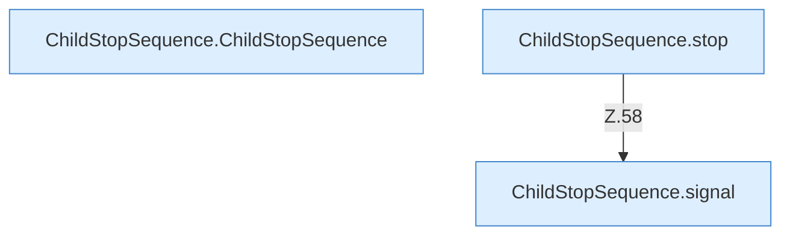
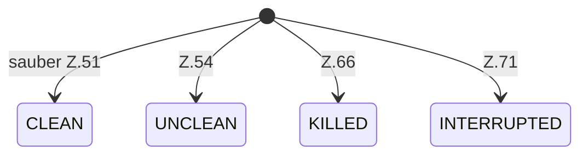

[[00 Start]] › [[Child-Prozess]] › [[Prozess-Bausteine]] › [[ChildStopSequence]]

# ChildStopSequence



```knoten
ChildStopSequence.ChildStopSequence
  Dieser Teil stoppt die Reihenfolge. Im [[Glossar#Quelltext|Quelltext]] heißt das `ChildStopSequence`.
ChildStopSequence.stop
  Dieser Teil stoppt das. Im [[Glossar#Quelltext|Quelltext]] heißt das `stop`.
ChildStopSequence.signal
  Dieser Teil macht hier einen einzelnen Schritt. Eine Ebene tiefer steht er genauer. Im [[Glossar#Quelltext|Quelltext]] heißt das `signal`.
```

> [!knoten]- Was die Blöcke tun
> - **ChildStopSequence.ChildStopSequence**: Dieser Teil stoppt die Reihenfolge. Im [[Glossar#Quelltext|Quelltext]] heißt das `ChildStopSequence`.
> - **ChildStopSequence.stop**: Dieser Teil stoppt das. Im [[Glossar#Quelltext|Quelltext]] heißt das `stop`.
> - **ChildStopSequence.signal**: Dieser Teil macht hier einen einzelnen Schritt. Eine Ebene tiefer steht er genauer. Im [[Glossar#Quelltext|Quelltext]] heißt das `signal`.



- Die Schritte des [[Glossar#Stopp|Stopps]]: nachfragen, die Bitte wiederholen, dann hart beenden.
