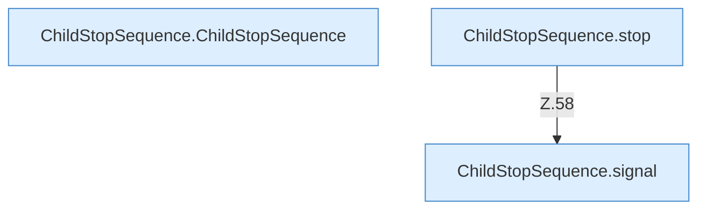
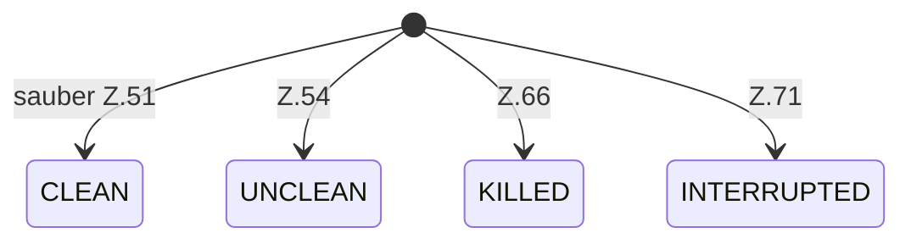

[[00 Start]] › [[Child-Prozess]] › [[Prozess-Bausteine]] › [[ChildStopSequence]]

# ChildStopSequence



```knoten
ChildStopSequence.ChildStopSequence
  Betrifft den Child `ChildStopSequence`.
ChildStopSequence.stop
  Stoppt `stop`. Ruft `signal`.
ChildStopSequence.signal
  `signal` in `ChildStopSequence.java`.
```




