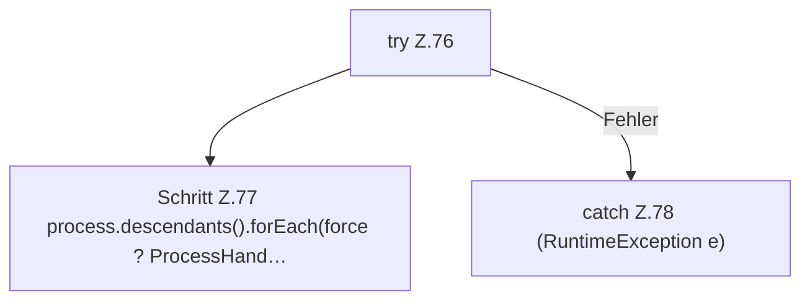

[[00 Start]] › [[Child-Prozess]] › [[Prozess-Bausteine]] › [[ChildStopSequence]] › [[ChildStopSequence.signal]]

# ChildStopSequence.signal

`ChildStopSequence.signal(Process process, boolean force, Consumer<String> log)` [src/main/java/de/aichele/childlauncher/ChildStopSequence.java:75–81](https://github.com/Sciddie/minecraft-serverhoster-plugin/blob/95b02b953b0b4c23673e900e021a7c3c844aa37d/src/main/java/de/aichele/childlauncher/ChildStopSequence.java#L75-L81)



```knoten
try Z.76
  Zeile 76: Versuch. Der Fehlerpfad geht in catch.
Schritt Z.77 process.descendants().forEach(force ? ProcessHand…
  Zeile 77: `process.descendants().forEach(force ? ProcessHand…`
catch Z.78 (RuntimeException e)
  Zeile 78: fängt (RuntimeException e).
```

> [!knoten]- Was die Blöcke tun
> - **try Z.76**: Zeile 76: Versuch. Der Fehlerpfad geht in catch.
> - **Schritt Z.77 process.descendants().forEach(force ? ProcessHand…**: Zeile 77: `process.descendants().forEach(force ? ProcessHand…`
> - **catch Z.78 (RuntimeException e)**: Zeile 78: fängt (RuntimeException e).

- Dieser Teil macht hier einen einzelnen Schritt. Eine Ebene tiefer steht er genauer.
- `signal` in `src/main/java/de/aichele/childlauncher/ChildStopSequence.java`
