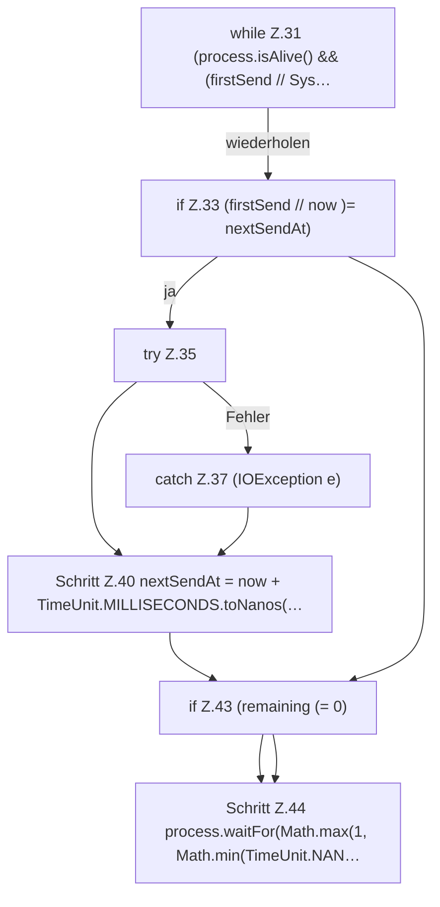

[[00 Start]] › [[Child-Prozess]] › [[Prozess-Bausteine]] › [[ChildStopSequence]] › [[ChildStopSequence.stop]] › [[ChildStopSequence.stop.Z21.Teil1.Z31]]

# ChildStopSequence.stop.Z21.Teil1.Z31



```knoten
while Z.31 (process.isAlive() && (firstSend // Sys…
  Zeile 31: Schleife `(process.isAlive() && (firstSend // Sys…`.
if Z.33 (firstSend // now )= nextSendAt)
  Zeile 33: prüft `(firstSend // now )= nextSendAt)`.
try Z.35
  Zeile 35: Versuch. Der Fehlerpfad geht in catch.
catch Z.37 (IOException e)
  Zeile 37: fängt (IOException e).
Schritt Z.40 nextSendAt = now + TimeUnit.MILLISECONDS.toNanos(…
  Zeile 40: rechnet Zeit um oder wartet. `nextSendAt = now + TimeUnit.MILLISECONDS.toNanos(…`
if Z.43 (remaining (= 0)
  Zeile 43: prüft `(remaining (= 0)`.
Schritt Z.44 process.waitFor(Math.max(1, Math.min(TimeUnit.NAN…
  Zeile 44: rechnet Zeit um oder wartet. `process.waitFor(Math.max(1, Math.min(TimeUnit.NAN…`
```

> [!knoten]- Was die Blöcke tun
> - **while Z.31 (process.isAlive() && (firstSend // Sys…**: Zeile 31: Schleife `(process.isAlive() && (firstSend // Sys…`.
> - **if Z.33 (firstSend // now )= nextSendAt)**: Zeile 33: prüft `(firstSend // now )= nextSendAt)`.
> - **try Z.35**: Zeile 35: Versuch. Der Fehlerpfad geht in catch.
> - **catch Z.37 (IOException e)**: Zeile 37: fängt (IOException e).
> - **Schritt Z.40 nextSendAt = now + TimeUnit.MILLISECONDS.toNanos(…**: Zeile 40: rechnet Zeit um oder wartet. `nextSendAt = now + TimeUnit.MILLISECONDS.toNanos(…`
> - **if Z.43 (remaining (= 0)**: Zeile 43: prüft `(remaining (= 0)`.
> - **Schritt Z.44 process.waitFor(Math.max(1, Math.min(TimeUnit.NAN…**: Zeile 44: rechnet Zeit um oder wartet. `process.waitFor(Math.max(1, Math.min(TimeUnit.NAN…`

- Der Ablauf geht in [[Glossar#Zeile|Zeile]] 31 weiter. Eine Ebene tiefer steht er genauer.
- Fortsetzung von `ChildStopSequence.stop.Z21.Teil1`.
