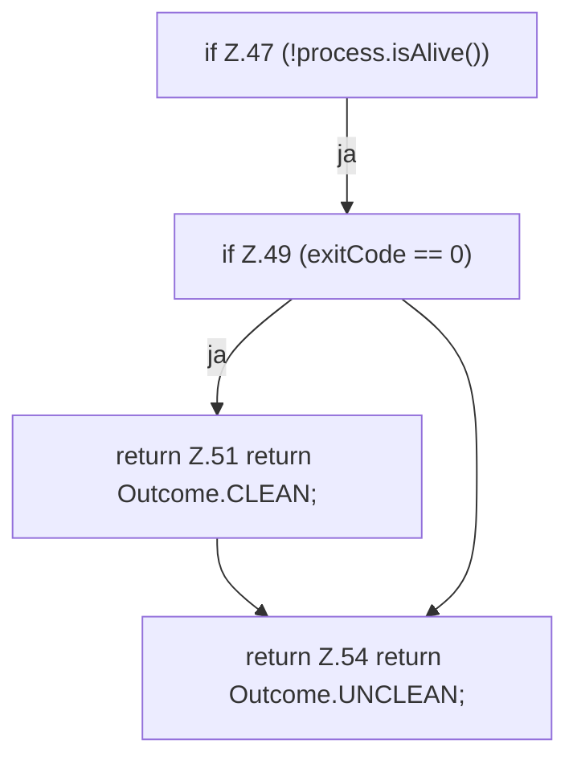

[[00 Start]] › [[Child-Prozess]] › [[Prozess-Bausteine]] › [[ChildStopSequence]] › [[ChildStopSequence.stop]] › [[ChildStopSequence.stop.Z21.Teil1.Z47]]

# ChildStopSequence.stop.Z21.Teil1.Z47



```knoten
if Z.47 (!process.isAlive())
  Zeile 47: prüft `(!process.isAlive())`.
if Z.49 (exitCode == 0)
  Zeile 49: prüft `(exitCode == 0)`.
return Z.51 return Outcome.CLEAN;
  Zeile 51: Rückgabe `return Outcome.CLEAN;`.
return Z.54 return Outcome.UNCLEAN;
  Zeile 54: Rückgabe `return Outcome.UNCLEAN;`.
```

> [!knoten]- Was die Blöcke tun
> - **if Z.47 (!process.isAlive())**: Zeile 47: prüft `(!process.isAlive())`.
> - **if Z.49 (exitCode == 0)**: Zeile 49: prüft `(exitCode == 0)`.
> - **return Z.51 return Outcome.CLEAN;**: Zeile 51: Rückgabe `return Outcome.CLEAN;`.
> - **return Z.54 return Outcome.UNCLEAN;**: Zeile 54: Rückgabe `return Outcome.UNCLEAN;`.

- Der Ablauf geht in [[Glossar#Zeile|Zeile]] 47 weiter. Eine Ebene tiefer steht er genauer.
- Fortsetzung von `ChildStopSequence.stop.Z21.Teil1`.
