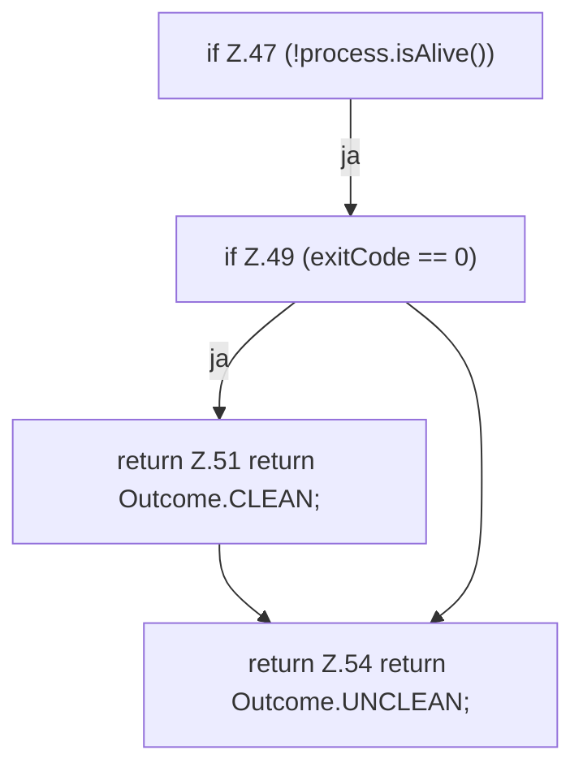

[[00 Start]] › [[Child-Prozess]] › [[Prozess-Bausteine]] › [[ChildStopSequence]] › [[ChildStopSequence.stop]] › [[ChildStopSequence.stop.Z21.Teil1.Z47]]

# ChildStopSequence.stop.Z21.Teil1.Z47

- Fortsetzung von `ChildStopSequence.stop.Z21.Teil1`, Quellreihenfolge.
