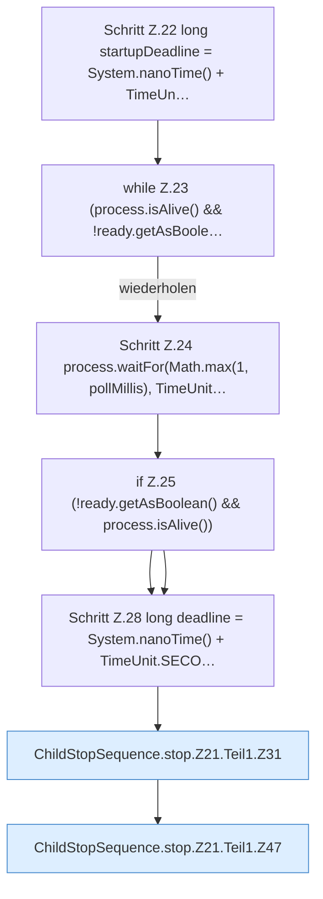

[[00 Start]] › [[Child-Prozess]] › [[Prozess-Bausteine]] › [[ChildStopSequence]] › [[ChildStopSequence.stop]] › [[ChildStopSequence.stop.Z21.Teil1]]

# ChildStopSequence.stop.Z21.Teil1



```knoten
Schritt Z.22 long startupDeadline = System.nanoTime() + TimeUn…
  Zeile 22: `long startupDeadline = System.nanoTime() + TimeUn…`
while Z.23 (process.isAlive() && !ready.getAsBoole…
  Zeile 23: Schleife `(process.isAlive() && !ready.getAsBoole…`.
Schritt Z.24 process.waitFor(Math.max(1, pollMillis), TimeUnit…
  Zeile 24: `process.waitFor(Math.max(1, pollMillis), TimeUnit…`
if Z.25 (!ready.getAsBoolean() && process.isAlive())
  Zeile 25: prüft `(!ready.getAsBoolean() && process.isAlive())`.
Schritt Z.28 long deadline = System.nanoTime() + TimeUnit.SECO…
  Zeile 28: rechnet Zeit um oder wartet. `long deadline = System.nanoTime() + TimeUnit.SECO…`
ChildStopSequence.stop.Z21.Teil1.Z31
  Der Ablauf geht in [[Glossar#Zeile|Zeile]] 31 weiter. Eine Ebene tiefer steht er genauer. Fortsetzung des Ablaufs ab Zeile 31.
ChildStopSequence.stop.Z21.Teil1.Z47
  Der Ablauf geht in [[Glossar#Zeile|Zeile]] 47 weiter. Eine Ebene tiefer steht er genauer. Fortsetzung des Ablaufs ab Zeile 47.
```

> [!knoten]- Was die Blöcke tun
> - **Schritt Z.22 long startupDeadline = System.nanoTime() + TimeUn…**: Zeile 22: `long startupDeadline = System.nanoTime() + TimeUn…`
> - **while Z.23 (process.isAlive() && !ready.getAsBoole…**: Zeile 23: Schleife `(process.isAlive() && !ready.getAsBoole…`.
> - **Schritt Z.24 process.waitFor(Math.max(1, pollMillis), TimeUnit…**: Zeile 24: `process.waitFor(Math.max(1, pollMillis), TimeUnit…`
> - **if Z.25 (!ready.getAsBoolean() && process.isAlive())**: Zeile 25: prüft `(!ready.getAsBoolean() && process.isAlive())`.
> - **Schritt Z.28 long deadline = System.nanoTime() + TimeUnit.SECO…**: Zeile 28: rechnet Zeit um oder wartet. `long deadline = System.nanoTime() + TimeUnit.SECO…`
> - **ChildStopSequence.stop.Z21.Teil1.Z31**: Der Ablauf geht in [[Glossar#Zeile|Zeile]] 31 weiter. Eine Ebene tiefer steht er genauer. Fortsetzung des Ablaufs ab Zeile 31.
> - **ChildStopSequence.stop.Z21.Teil1.Z47**: Der Ablauf geht in [[Glossar#Zeile|Zeile]] 47 weiter. Eine Ebene tiefer steht er genauer. Fortsetzung des Ablaufs ab Zeile 47.

- Ein weiterer Abschnitt derselben Übersicht.
- Fortsetzung von `ChildStopSequence.stop.Z21`.
