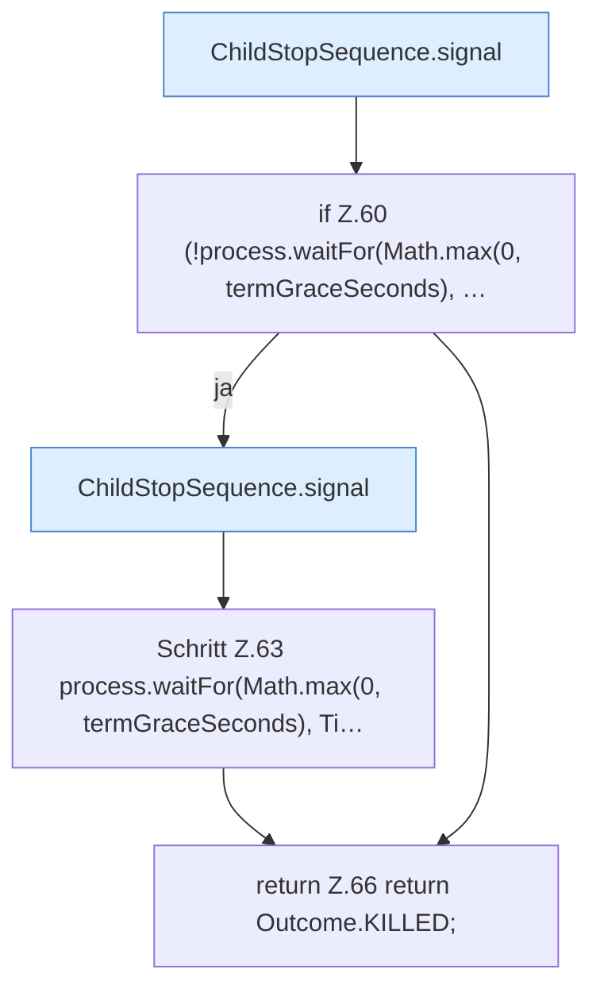

[[00 Start]] › [[Child-Prozess]] › [[Prozess-Bausteine]] › [[ChildStopSequence]] › [[ChildStopSequence.stop]] › [[ChildStopSequence.stop.Z21.Teil2]]

# ChildStopSequence.stop.Z21.Teil2



```knoten
ChildStopSequence.signal
  Dieser Teil macht hier einen einzelnen Schritt. Eine Ebene tiefer steht er genauer. `signal` in `ChildStopSequence.java`.
if Z.60 (!process.waitFor(Math.max(0, termGraceSeconds), …
  Zeile 60: prüft `(!process.waitFor(Math.max(0, termGraceSeconds), …`.
Schritt Z.63 process.waitFor(Math.max(0, termGraceSeconds), Ti…
  Zeile 63: `process.waitFor(Math.max(0, termGraceSeconds), Ti…`
return Z.66 return Outcome.KILLED;
  Zeile 66: Rückgabe `return Outcome.KILLED;`.
```

> [!knoten]- Was die Blöcke tun
> - **ChildStopSequence.signal**: Dieser Teil macht hier einen einzelnen Schritt. Eine Ebene tiefer steht er genauer. `signal` in `ChildStopSequence.java`.
> - **if Z.60 (!process.waitFor(Math.max(0, termGraceSeconds), …**: Zeile 60: prüft `(!process.waitFor(Math.max(0, termGraceSeconds), …`.
> - **Schritt Z.63 process.waitFor(Math.max(0, termGraceSeconds), Ti…**: Zeile 63: `process.waitFor(Math.max(0, termGraceSeconds), Ti…`
> - **return Z.66 return Outcome.KILLED;**: Zeile 66: Rückgabe `return Outcome.KILLED;`.

- Ein weiterer Abschnitt derselben Übersicht.
- Fortsetzung von `ChildStopSequence.stop.Z21`.
