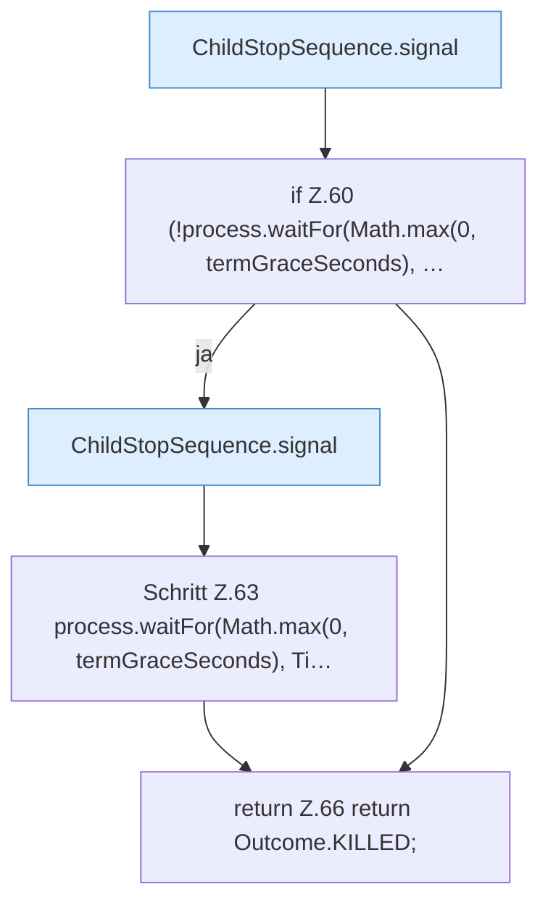

[[00 Start]] › [[Child-Prozess]] › [[Prozess-Bausteine]] › [[ChildStopSequence]] › [[ChildStopSequence.stop]] › [[ChildStopSequence.stop.Z21.Teil2]]

# ChildStopSequence.stop.Z21.Teil2

- Fortsetzung von `ChildStopSequence.stop.Z21`, Quellreihenfolge.
