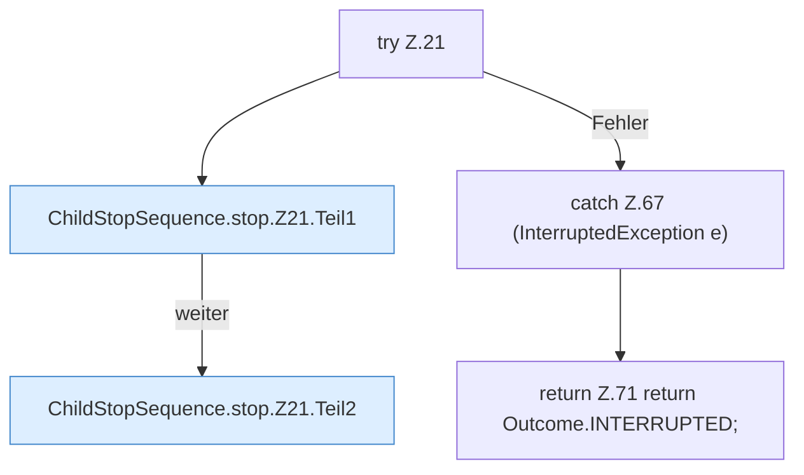

[[00 Start]] › [[Child-Prozess]] › [[Prozess-Bausteine]] › [[ChildStopSequence]] › [[ChildStopSequence.stop]] › [[ChildStopSequence.stop.Z21]]

# ChildStopSequence.stop.Z21



```knoten
try Z.21
  Zeile 21: Versuch. Der Fehlerpfad geht in catch.
ChildStopSequence.stop.Z21.Teil1
  Ein weiterer Abschnitt derselben Übersicht. Abschnitt 1 dieses Ablaufs, in Quellreihenfolge.
ChildStopSequence.stop.Z21.Teil2
  Ein weiterer Abschnitt derselben Übersicht. Abschnitt 2 dieses Ablaufs, in Quellreihenfolge.
catch Z.67 (InterruptedException e)
  Zeile 67: fängt (InterruptedException e).
return Z.71 return Outcome.INTERRUPTED;
  Zeile 71: Rückgabe `return Outcome.INTERRUPTED;`.
```

> [!knoten]- Was die Blöcke tun
> - **try Z.21**: Zeile 21: Versuch. Der Fehlerpfad geht in catch.
> - **ChildStopSequence.stop.Z21.Teil1**: Ein weiterer Abschnitt derselben Übersicht. Abschnitt 1 dieses Ablaufs, in Quellreihenfolge.
> - **ChildStopSequence.stop.Z21.Teil2**: Ein weiterer Abschnitt derselben Übersicht. Abschnitt 2 dieses Ablaufs, in Quellreihenfolge.
> - **catch Z.67 (InterruptedException e)**: Zeile 67: fängt (InterruptedException e).
> - **return Z.71 return Outcome.INTERRUPTED;**: Zeile 71: Rückgabe `return Outcome.INTERRUPTED;`.

- Der Ablauf geht in [[Glossar#Zeile|Zeile]] 21 weiter. Eine Ebene tiefer steht er genauer.
- Fortsetzung von `ChildStopSequence.stop`.
