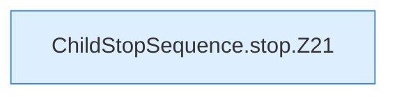

[[00 Start]] › [[Child-Prozess]] › [[Prozess-Bausteine]] › [[ChildStopSequence]] › [[ChildStopSequence.stop]]

# ChildStopSequence.stop

`ChildStopSequence.stop(Process process, BooleanSupplier ready, long startupSeconds, long stopSeconds, long pollMillis, long resendMillis, long termGraceSeconds, StopSender sender, Consumer<String> log, String name)` [src/main/java/de/aichele/childlauncher/ChildStopSequence.java:17–73](https://github.com/Sciddie/minecraft-serverhoster-plugin/blob/95b02b953b0b4c23673e900e021a7c3c844aa37d/src/main/java/de/aichele/childlauncher/ChildStopSequence.java#L17-L73)



```knoten
ChildStopSequence.stop.Z21
  Fortsetzung des Ablaufs ab Zeile 21.
```

- `stop` in `src/main/java/de/aichele/childlauncher/ChildStopSequence.java`
