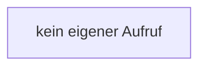

[[00 Start]] › [[Child-Prozess]] › [[Prozess-Bausteine]] › [[ConsoleBuffer]] › [[ConsoleBuffer.ConsoleBuffer]]

# ConsoleBuffer.ConsoleBuffer

`ConsoleBuffer.ConsoleBuffer(int cap)` [src/main/java/de/aichele/childlauncher/ConsoleBuffer.java:13–13](https://github.com/Sciddie/minecraft-serverhoster-plugin/blob/95b02b953b0b4c23673e900e021a7c3c844aa37d/src/main/java/de/aichele/childlauncher/ConsoleBuffer.java#L13-L13)

- `ConsoleBuffer` in `src/main/java/de/aichele/childlauncher/ConsoleBuffer.java`
