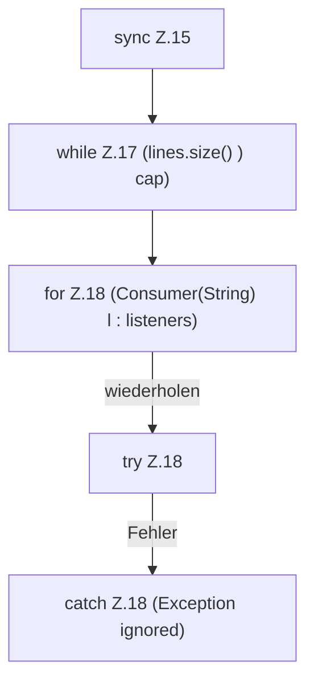

[[00 Start]] › [[Child-Prozess]] › [[Prozess-Bausteine]] › [[ConsoleBuffer]] › [[ConsoleBuffer.add]] › [[ConsoleBuffer.add.Z15]]

# ConsoleBuffer.add.Z15

- Fortsetzung von `ConsoleBuffer.add`, Quellreihenfolge.
